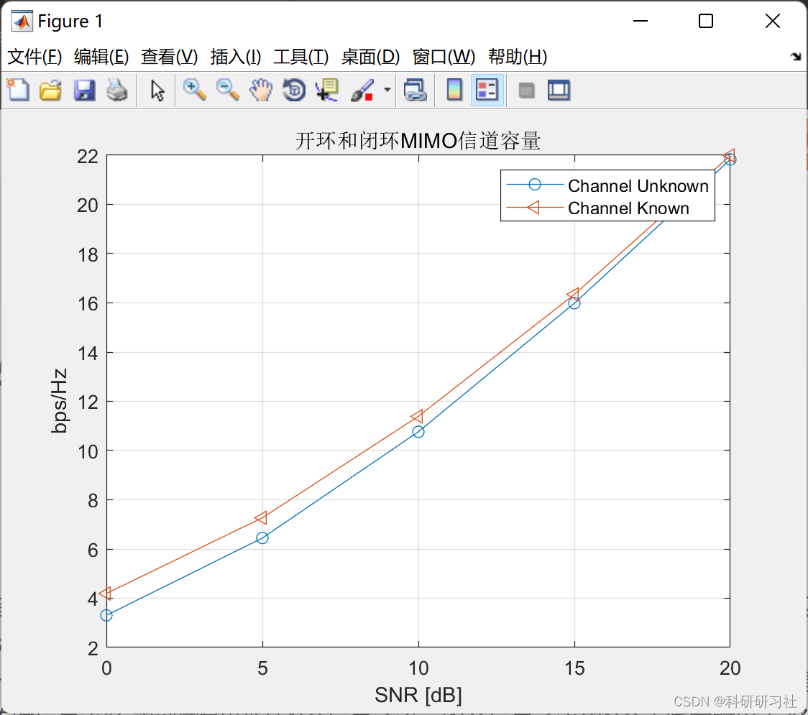
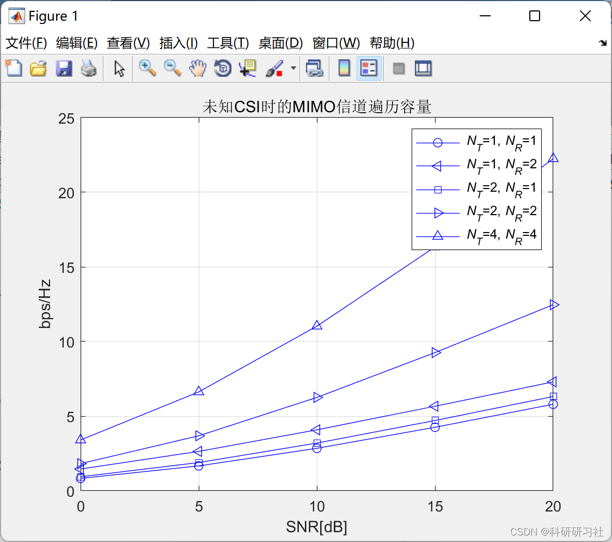
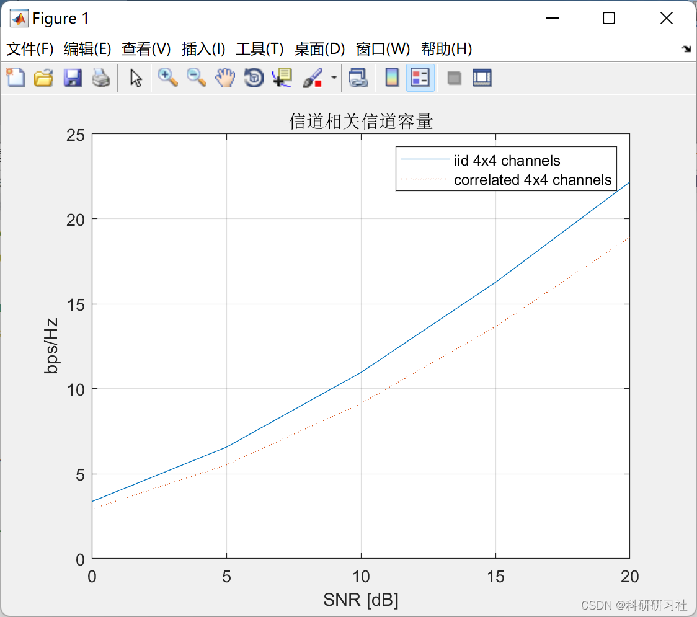
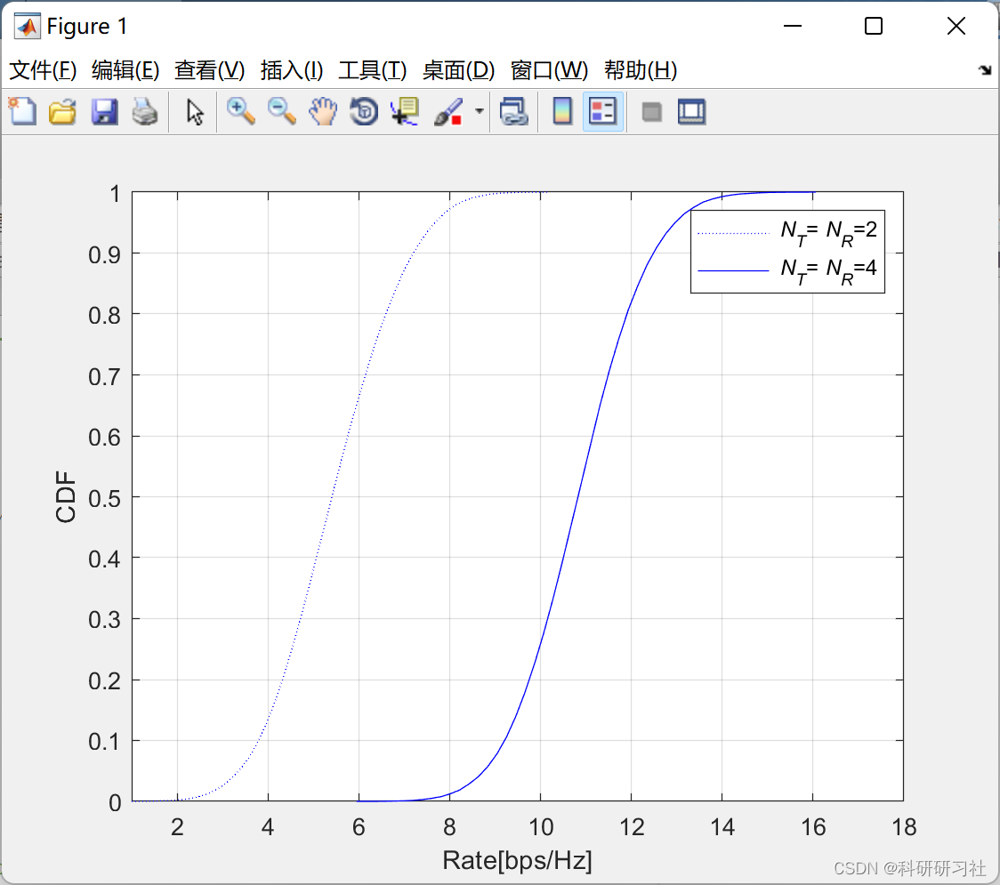
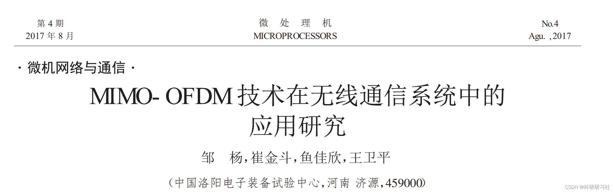

# [Signal Processing]MIMO Channel Capacity (Matlab Code Implementation)

​  
Contents
1. Overview
2. Running results
3. MATLAB code implementation
4 Outlook
5. References
6. Conclusion
1. Overview of MIMO: It refers to a technology where multiple transmitting antennas and receiving antennas are used at both the transmitter and receiver ends. Traditional communication systems are single-input, single-output (SISQ) systems. Additionally, multi-input, single-output (MISO) methods based on transmit diversity and receive diversity, as well as single-input, multiple-output (SIM) methods, are also integral to MIMO. The information stream is transmitted through space-time encoding to form N information substreams. These N information substreams are emitted by N antennas and received by M receiving antennas through the spatial channel. Multi-antenna receivers can distinguish and decode these data substreams using space-time coding processing, thereby achieving optimal processing. These N information substreams are simultaneously transmitted to the channel, occupying the same frequency band, thus not increasing bandwidth. If the channel response between each transmit and receive antenna is independent, a MIMO system can create multiple parallel spatial channels. By transmitting information independently through these parallel spatial channels, the data transmission rate is enhanced.
2. Running results editing
3. MATLAB code implementation
[Signal Processing]MIMO Channel Capacity (Matlab Code Implementation)
% Ergodic_Capacity_CDF.m\nclear all;\nclose all;\nfigure\nSNR_dB=10;  \nSNR_linear=10.^(SNR_dB/10.);\nN_iter=50000; \nsq2=sqrt(0.5); \ngrps = ['b:'; 'b-'];\nfor Icase=1:2 \n   if Icase==1\n       nT=2; \n       nR=2;  % 2x2\n   else\n       nT=4; \n       nR=4;       % 4x4\n   end\n   n=min(nT,nR);  \n   I = eye(n);\n   for iter=1:N_iter\n      H = sq2*(randn(nR,nT)+j*randn(nR,nT)); \n      C(iter) = log2(real(det(I+SNR_linear/nT*H'*H)));\n   end\n   [PDF,Rate] = hist(C,50);\n   PDF = PDF/N_iter;\n   for i=1:50\n       CDF(Icase,i) = sum(PDF([1:i]));  \n   end\n   plot(Rate,CDF(Icase,:),grps(Icase,:)); \n   hold on\nend\nxlabel('Rate[bps/Hz]');\nylabel('CDF');\naxis([1 18 0 1]); \ngrid on; \nset(gca,'fontsize',10); \nlegend('{\it N_T}={\it N_R}=2','{\it N_T}={\it N_R}=4');\n\n  
4. Summary of Outlook: MIMO technology involves using multiple transmitting and receiving antennas at both the transmitter and receiver ends, which can double the capacity and channel utilization of a communication system without increasing bandwidth. OFDM technology involves "dividing" the available frequency bands and performing "serial-to-parallel conversion," which increases the symbol period on subchannels and reduces or even eliminates Intersymbol Interference (ISI) on each subchannel, thereby effectively combating channel fading. Through the elucidation of MIMO-OFDM principles and the derivation of the channel capacity formula, an approximated channel capacity is obtained.
After formulating the system, it combines the advantages of both to construct a MIMO-OFDM wireless local area network system. The MATLAB tool is applied to simulate and compare the integration of MIM and OFDM technologies, modulation methods, number of transmitters and receivers, etc., qualitatively determining the impact on the system's error rate.
The impact factor of the bitrate.
​  

## Images

<!-- PAYMENT_BLOCK -->

## Get this dataset

- Payment link (Stripe): [Buy now](https://buy.stripe.com/3cs8yP7sY87d0vu9AB)
- Payment QR code: 

<!-- /PAYMENT_BLOCK -->
